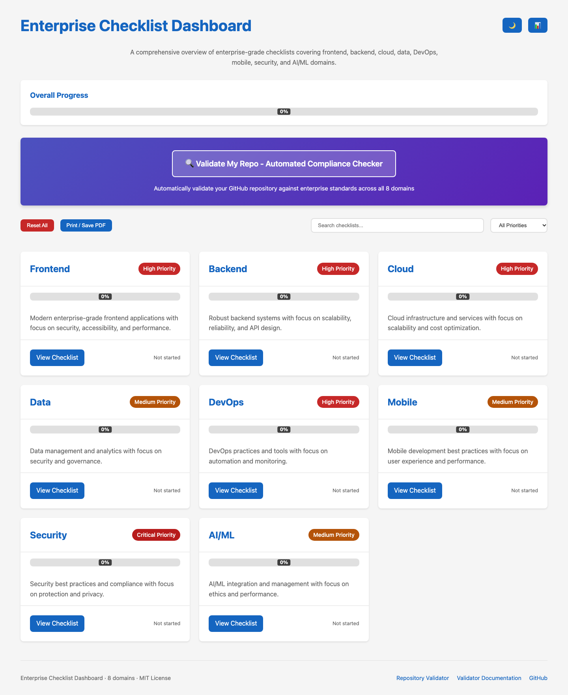
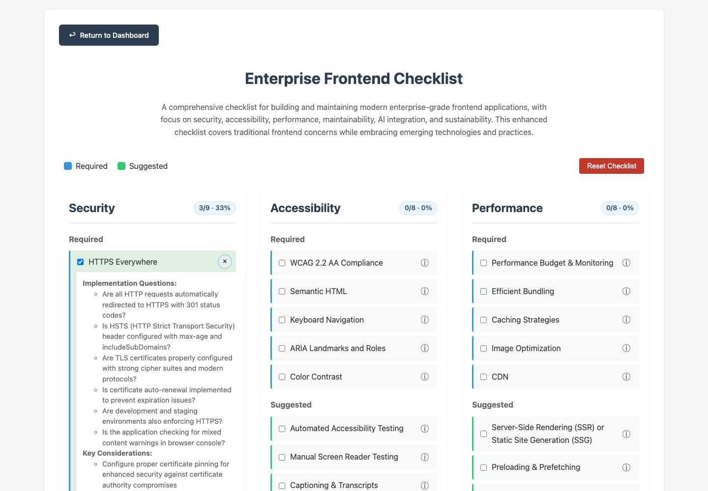
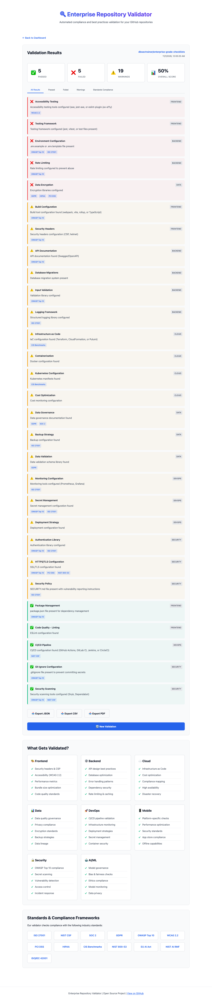

# Enterprise Checklist Dashboard

[](https://github.com/dbsectrainer/enterprise-grade-checklists/actions/workflows/ci.yml)
[](https://github.com/dbsectrainer/enterprise-grade-checklists/actions/workflows/pages.yml)

A static, browser-only dashboard for tracking progress across eight enterprise-grade checklists,
plus a repository validator that checks public GitHub repositories against the same domains.

**Live demo:** [https://dbsectrainer.github.io/enterprise-grade-checklists/](https://dbsectrainer.github.io/enterprise-grade-checklists/)

**Verification status (2026-10-31):** 9 unit tests and 53 Playwright end-to-end tests pass; the
production build is manifest-backed and was smoke-tested from `dist/`; zero WCAG 2.2 A/AA violations
were reported by axe on the dashboard (light and dark), all eight checklists, the validator form, and the validator results/standards views; the
validator completed a live GitHub API run. Full evidence is in
[docs/evidence/verification-report.md](docs/evidence/verification-report.md).

## Overview

The repository contains 505 checklist items across eight domains:

- Frontend (118 items)
- Backend (63)
- Cloud (44)
- Data (47)
- DevOps (46)
- Mobile (47)
- Security (84)
- AI/ML (56)

There is no server, database, account system, or build-time framework. The dashboard and checklist
content are static HTML, state is stored in the browser, and the validator calls the public GitHub
REST API directly from the page.

## Screenshots



_The dashboard at 1440px: weighted overall progress, domain cards, priority filter, exports, dark/light
theme, and the repository validator entry point._



_Checklist details now render at full item width. Clicking inside the panel no longer toggles the
checkbox or closes the panel._



_A live validator run against this repository. The result summary, failed/warning/passed ordering,
standards tags, and export actions are all rendered from the actual GitHub API response._

More screenshots, including mobile layouts and the standards tab, are indexed in
[docs/evidence/screenshots/manifest.json](docs/evidence/screenshots/manifest.json).

## Features (verified)

### Dashboard

- Weighted overall progress across all 505 checklist items, with per-domain progress bars and
  accessible `role="progressbar"` values.
- Per-domain "Updated …" timestamps from `localStorage`, with "Not started" when untouched.
- Search across domain cards and priority filtering (All, Critical, High, Medium), including a
  no-results state.
- Search and filter state persisted for the current browser tab with `sessionStorage`.
- Light and dark themes, persisted across visits, with an accessible toggle state.
- Export progress as JSON or CSV, including checked/total counts and an overall score.
- Print / Save PDF through the browser print dialog and a dedicated print stylesheet.
- Accessible export dialog with keyboard dismissal, focus restoration, and backdrop dismissal.
- Reset-all confirmation and cross-tab synchronization: checking an item in one tab updates an open
  dashboard in another tab.

### Checklist pages

- 505 items with required/suggested grouping and expandable implementation details.
- Semantically valid markup: every item is a `div.checklist-item` containing a single `label`,
  a sibling details toggle, and a sibling details panel. No interactive content is nested in a
  `label`.
- Per-section progress badges (checked/total and percentage) that update immediately.
- Checkbox state and last-updated timestamps persisted per checklist.
- Full-width details panels; clicking text inside a panel does not toggle the checkbox.
- Native button keyboard behavior (Enter/Space) and Escape to close open panels.
- `aria-expanded`/`aria-controls` state on every details toggle.
- Reset with confirmation, and mobile layouts at 390px without horizontal overflow.

### Repository Validator

- Accepts `https://github.com/owner/repo`, `github.com/owner/repo`, `www.github.com`, `.git` suffix,
  and repository URLs with additional path segments; validates the hostname rather than matching a
  substring.
- Eight domains: frontend, backend, cloud, data, DevOps, mobile, security, and AI/ML.
- Standards tags for ISO 27001, NIST CSF, SOC 2, GDPR, OWASP Top 10, WCAG 2.2, PCI DSS, HIPAA,
  CIS Benchmarks, NIST 800-53, EU AI Act, NIST AI RMF, and ISO/IEC 42001.
- Inline form errors instead of blocking `alert()` dialogs.
- Actionable errors for missing/private repositories, rate limits (including reset time), and
  network failures.
- Fetches the repository, root contents, languages, and root `package.json` once each; unused commit
  data is no longer requested and duplicate manifest fetches are eliminated.
- Result tabs with ARIA tab semantics and arrow-key navigation, a standards view, JSON/CSV export,
  and print-to-PDF.
- Escapes all interpolated result text before writing HTML.

## Technology Stack

| Layer                 | Choice                                                                           |
| --------------------- | -------------------------------------------------------------------------------- |
| UI                    | Semantic HTML5, CSS custom properties, responsive CSS grid/flexbox               |
| Behavior              | Vanilla JavaScript (ES2021+), no runtime framework                               |
| Persistence           | `localStorage` for progress/theme, `sessionStorage` for tab-scoped filters       |
| External API          | GitHub REST API and `raw.githubusercontent.com` (public data only)               |
| Hosting               | Static files / GitHub Pages                                                      |
| Linting               | ESLint 10, Prettier 3                                                            |
| HTML validation       | html-validate 10                                                                 |
| E2E and accessibility | Playwright 1.64, `@axe-core/playwright` (WCAG 2.2 A/AA tags)                     |
| Unit tests            | Node.js built-in `node:test`                                                     |
| Build                 | Node.js static assembly script with link/invariant checks and a SHA-256 manifest |

## Prerequisites

- Node.js **22.13 or newer** (`.nvmrc` pins 22.13.0; CI uses the latest Node 22).
- npm (the repository includes `package-lock.json`).
- A modern browser: current Chrome, Edge, Firefox, or Safari. Automated browser verification was
  performed with Playwright Chromium.
- Network access for the repository validator. Checklist tracking itself is fully offline after the
  static files load.

## Installation and Development

```bash
git clone https://github.com/dbsectrainer/enterprise-grade-checklists.git
cd enterprise-grade-checklists
npm ci
npm run serve
```

Open [http://127.0.0.1:3000/](http://127.0.0.1:3000/). The dashboard links to the validator and to
each checklist.

The site is fully static. Opening `index.html` directly also works for the dashboard and checklists
in most browsers, but a local server is recommended because `localStorage` behavior on `file://`
varies by browser. Use the server for the validator so its script and fetch behavior match
deployment.

## Commands

| Command                 | Purpose                                                                                                             |
| ----------------------- | ------------------------------------------------------------------------------------------------------------------- |
| `npm run serve`         | Serve the repository on port 3000.                                                                                  |
| `npm run lint`          | Run ESLint over the repository.                                                                                     |
| `npm run format`        | Format HTML, CSS, JS/MJS, JSON, and Markdown with Prettier.                                                         |
| `npm run format:check`  | Verify formatting without writing.                                                                                  |
| `npm run validate:html` | Validate structural HTML rules (`close-order`, permitted content, duplicate IDs, label/control count, button type). |
| `npm run test:unit`     | Run 9 Node unit tests for URL parsing, escaping, rate-limit messages, markup invariants, and validator regressions. |
| `npm run test:e2e`      | Run 53 Playwright tests (install browsers first: `npx playwright install chromium`).                                |
| `npm test`              | Run unit tests, then the Playwright suite.                                                                          |
| `npm run build`         | Assemble the deployable site into `dist/` and write `dist/build-manifest.json`.                                     |
| `npm run verify:dist`   | Serve `dist/` and smoke-test every page for HTTP, console, network, and content errors.                             |
| `npm run capture`       | Re-capture the evidence screenshots and manifest from the running app. Requires network for the live validator run. |

### First-time Playwright setup

```bash
npx playwright install chromium
# On a fresh Linux CI runner:
npx playwright install --with-deps chromium
```

If the default browser cache is not writable (some managed machines), install and run with a
workspace-local path:

```bash
PLAYWRIGHT_BROWSERS_PATH="$PWD/.playwright-browsers" npx playwright install chromium
PLAYWRIGHT_BROWSERS_PATH="$PWD/.playwright-browsers" npm run test:e2e
```

## Production Build

```bash
npm run build
npm run verify:dist
```

`dist/` contains the browser assets, documentation, verification evidence, and the build manifest.
It excludes tests, Playwright reports, browser caches, and legacy/unwired developer scripts. Every
local link in the built HTML and Markdown is checked during the build, and the key content
invariants (eight cards, accessible checklist markup) are enforced.

To preview the artifact manually:

```bash
npx http-server dist -p 3001 -c-1
```

The GitHub Pages workflow also builds `dist/` and deploys that artifact, rather than deploying the
repository root.

## Environment Configuration

No environment variables, API keys, or secrets are required or read by the application.

The validator uses the unauthenticated GitHub REST API:

- 60 requests per hour per public IP.
- Public repositories only.
- Four requests per validation: repository metadata, root contents, languages, and the root
  `package.json` when present.
- Rate-limit failures are shown inline with the reset time.

No credentials are collected, stored, or transmitted by this project. Progress remains in the
browser and is never uploaded.

## Data and State

| Key                                                    | Storage          | Purpose                                     |
| ------------------------------------------------------ | ---------------- | ------------------------------------------- |
| `frontendChecklistStates`, `backendChecklistStates`, … | `localStorage`   | Indexed checkbox state per checklist.       |
| `frontendLastUpdated`, `backendLastUpdated`, …         | `localStorage`   | ISO timestamp of the last checklist change. |
| `theme`                                                | `localStorage`   | `light` or `dark` preference.               |
| `dashboardSearch`                                      | `sessionStorage` | Current tab's search term.                  |
| `dashboardFilter`                                      | `sessionStorage` | Current tab's priority filter.              |

Clearing site data resets progress. The dashboard's "Reset All" and each checklist's "Reset
Checklist" only clear this project's keys after confirmation.

## Project Structure

```
.
├── index.html                    # Dashboard
├── script.js                     # Dashboard state, filters, exports, theme, dialog
├── styles.css                    # Dashboard styles and print styles
├── validator.html               # Repository validator UI
├── validator.js                 # Validator UI, GitHub API integration, results
├── validator-utils.js           # Testable URL parsing, escaping, rate-limit helpers
├── validator.css                # Validator styles and print styles
├── standards-mapping.json       # Reference mapping used by the documentation
├── favicon.svg
├── enterprise-frontend-checklist/
│   ├── index.html               # 118 checklist items
│   ├── script.js                # Shared behavior with frontend storage key
│   ├── styles.css               # Shared checklist styling
│   ├── frontend-validator.js    # Legacy, unwired developer script (see limitations)
│   └── README.md
├── enterprise-{backend,cloud,data,devops,mobile,security,aiml}-checklist/
│   └── …                        # Same shape, domain-specific content
├── tests/
│   ├── unit/                    # Node unit tests
│   └── e2e/                     # Playwright tests and accessibility checks
├── scripts/
│   ├── build.mjs                # Production assembly + manifest
│   ├── verify-dist.mjs          # Production artifact smoke test
│   └── capture-evidence.mjs     # Screenshot/evidence capture
├── docs/
│   ├── ROADMAP.md
│   ├── CASE_STUDY.md
│   ├── CHANGELOG.md
│   ├── CONTRIBUTING.md
│   ├── VALIDATOR.md
│   ├── VALIDATOR_IMPROVEMENT_PLAN.md
│   ├── diagrams/
│   └── evidence/
│       ├── screenshots/
│       ├── test-results/
│       ├── build-results/
│       └── verification-report.md
├── .github/workflows/ci.yml
├── .github/workflows/pages.yml
├── playwright.config.js
├── .htmlvalidate.json
└── package.json
```

## Architecture

- **Static-first:** every page is standalone HTML. There is no runtime server or build framework.
- **Embedded content:** checklist items and details live in the domain HTML files; the scripts only
  add behavior and progress. Updating checklist content means editing the corresponding
  `index.html`.
- **Independent state:** each checklist uses its own storage keys and can be opened directly.
- **Cross-tab updates:** checklist changes write `localStorage`; the dashboard listens for `storage`
  events and recalculates progress without a reload.
- **Deterministic build:** `scripts/build.mjs` copies only browser assets, checks internal links and
  content invariants, and emits SHA-256 hashes. No minification or network access is involved.

Architecture diagrams are in [docs/diagrams](docs/diagrams/README.md).

## Validator Details and Limitations

The validator is a **screening tool**, not a compliance certification system. Current limitations:

1. **Public repositories only.** No GitHub token or private-repository authentication is supported.
2. **Root-level heuristics.** It inspects the repository root and root manifests. Nested
   `dashboard/`, `infra/`, `k8s/`, or monorepo package roots are not recursively scanned. This can
   produce false negatives for nested projects.
3. **npm-only dependency detection.** `package.json` dependencies/devDependencies are checked for
   known library names. Python (`requirements.txt`), Go (`go.mod`), Rust (`Cargo.toml`), Java, and
   other ecosystems are not dependency-scanned.
4. **Presence-based checks.** File names and dependency names indicate intent; they do not prove
   that a control is configured correctly or active at runtime.
5. **Filename heuristics.** Some checks match substrings (for example `security` or `test`) rather
   than a normalized manifest.
6. **Unauthenticated rate limits.** Large or repeated validations can hit the 60 requests/hour limit.
7. **No PDF library.** "Export PDF" uses the browser print dialog with a print stylesheet; the
   result depends on the browser's print destination.
8. **No persistence of validation history.** Each validation starts fresh; results are exported
   manually.

The proposed recursive tree walk, multi-ecosystem dependency resolver, stack detection, and fixture
suite are documented in
[docs/VALIDATOR_IMPROVEMENT_PLAN.md](docs/VALIDATOR_IMPROVEMENT_PLAN.md) and are **not implemented**
in this revision.

## Known Limitations

- The eight `enterprise-*-checklist/*-validator.js` files are legacy developer prototypes. They are
  not referenced by any page, use CommonJS while the package is ESM, and require packages that are
  not installed. They are retained for reference and should not be presented as a working feature.
  The browser validator (`validator.html`/`validator.js`) is the supported validation feature.
- Dashboard search filters the eight domain cards, not the 505 individual checklist items.
- Progress is browser-local. There is no account, cloud sync, or multi-device merge.
- Automated browser tests run on Chromium. Firefox and WebKit are supported by the code but were not
  executed in the recorded verification.
- GitHub Actions workflows were updated and validated as YAML, but could not be executed on GitHub
  from this environment. The equivalent commands were run locally.

## Documentation

- [Verification report and evidence](docs/evidence/verification-report.md)
- [Validator documentation](docs/VALIDATOR.md)
- [Validator improvement plan](docs/VALIDATOR_IMPROVEMENT_PLAN.md)
- [Changelog](docs/CHANGELOG.md)
- [Roadmap](docs/ROADMAP.md)
- [Case study](docs/CASE_STUDY.md)
- [Contributing](docs/CONTRIBUTING.md)

## Contributing

Please read [docs/CONTRIBUTING.md](docs/CONTRIBUTING.md). Before opening a pull request, run:

```bash
npm run lint
npm run format:check
npm run validate:html
npm test
npm run build
npm run verify:dist
```

## License

MIT — see [LICENSE](LICENSE).
